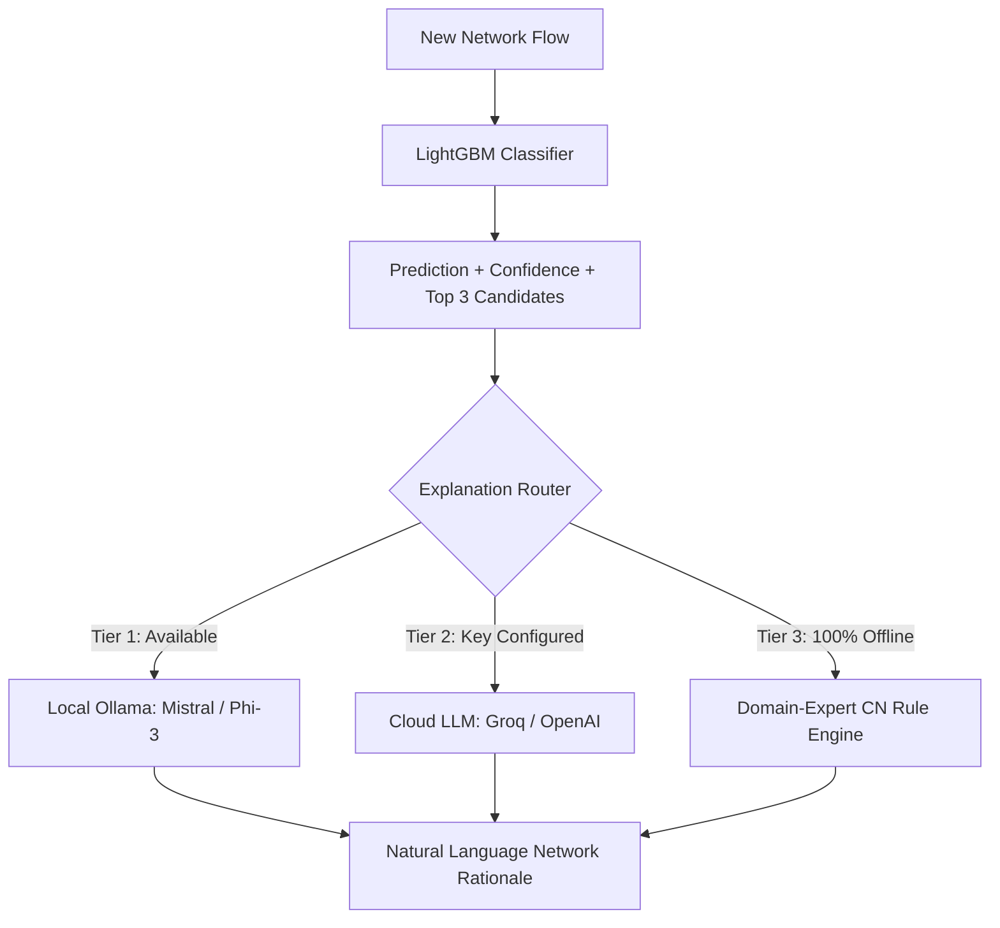

# 🛡️ Encrypted Traffic Classifier (Without Payload Inspection)

[](https://github.com/Abhinavbvs/encrypted-traffic-classifier/actions/workflows/ci.yml)
[](https://www.python.org/)
[](LICENSE)
[](tests/)
[](reports/metrics.json)
[](Dockerfile)

> **A high-speed, privacy-preserving Network Flow Classifier and Explainable AI (XAI) framework that ingests raw PCAP/PCAPNG packet captures and classifies encrypted traffic into 7 real-world application types using ONLY 23 timing statistics — with zero payload decryption and zero data leakage.**

---

## ⚡ Why This Project Outperforms Traditional Approaches

| Comparison Metric | Traditional Deep Packet Inspection (DPI) | IP / Port Number Based Heuristics | Deep Learning (1D-CNN / LSTM) | **Our Timing-Based LightGBM Model** |
| :--- | :---: | :---: | :---: | :---: |
| **Encrypted Traffic (TLS 1.3 / QUIC)** | ❌ Fails completely | ❌ Fails (Port 443 multiplexing) | ✅ Works | **✅ 96.9% Test Accuracy** |
| **User Privacy & Regulatory Compliance** | ❌ Violates GDPR/HIPAA | ⚠️ Privacy concerns | ✅ Privacy preserved | **✅ 100% Privacy (No payload inspection)** |
| **Raw Packet Capture Ingestion** | ❌ Requires decryption keys | ⚠️ Only inspects headers | ⚠️ Requires raw byte truncation | **✅ Native .pcap/.pcapng 5-tuple flow parser** |
| **Resistance to Port / IP Evasion** | ❌ Vulnerable | ❌ Easily bypassed | ✅ High | **✅ High (Transport rhythm cannot be spoofed)** |
| **Inference Latency** | ❌ 100ms - 500ms (Heavy decrypt) | ✅ < 1ms | ❌ 15ms - 40ms (Requires GPU) | **⚡ ~2.3 ms / flow (>400 flows/sec on CPU)** |
| **Interpretability / Explainability** | ⚠️ Plain text logs | ❌ None | ❌ Black box | **💡 Natural Language CN Explanations (Multi-Tier)** |
| **Middlebox Production Feasibility** | ❌ High hardware cost | ⚠️ Inaccurate | ❌ Expensive GPU middleboxes | **✅ Lightweight CPU deployment ready** |

---

## 🚀 Native PCAP / PCAPNG Ingestion & Flow Extraction Pipeline

This framework provides an end-to-end packet processing engine in `src/pcap_extractor.py` that ingests raw network traces without needing external proprietary tools:

```
           Raw Packet Capture (.pcap / .pcapng)
                            │
                            ▼
      [ Scapy Packet Filter & Header Parser ]
       - Extracts IPv4 / IPv6 network headers
       - Extracts TCP / UDP transport ports
       - Completely ignores and discards packet payload bytes
                            │
                            ▼
     [ Bidirectional 5-Tuple Flow Construction ]
       - Canonical Key: (IP_min, IP_max, Port_min, Port_max, Protocol)
       - Client/Server Initiator Tracking: Forward (Client➔Server) & Backward (Server➔Client)
                            │
                            ▼
       [ 23 Statistical Timing Features Computation ]
       - Duration, Throughput Rates (Bytes/s, Pkts/s)
       - Inter-Arrival Times: FIAT, BIAT, Flow IAT (Min, Mean, Max, Std)
       - Active Burst Periods & Idle Periods (5.0s threshold)
                            │
                            ▼
          [ Preprocessing & LightGBM Inference ]
       - Scaled with trained StandardScaler (Zero Leakage)
       - Predicts Top-1 Class + Full Probability Distribution
                            │
                            ▼
       [ Unknown Traffic Detection & Diagnostics ]
       - Confidence Threshold Filter flags anomalous/novel traffic
       - Interactive Streamlit Dashboard with Exportable CSV Reports
```

---

## 📊 Comprehensive Benchmarks & Model Evaluation

### 1. 5-Fold Stratified Cross-Validation Benchmark (7,389 Flows)
Evaluated across all candidate architectures on the combined Train + Validation splits (with 15% Test completely held out):

| Classifier | Accuracy (Mean &plusmn; SD) | Macro F1 (Mean &plusmn; SD) | Avg Fit Time | CPU Inference Latency |
| :--- | :---: | :---: | :---: | :---: |
| **Random Forest** (300 Trees) | 93.90% &plusmn; 0.88% | 0.9042 &plusmn; 0.0141 | 1.08s | 3.8 ms / flow |
| **XGBoost** (Hist Boosted) | 95.18% &plusmn; 0.48% | 0.9217 &plusmn; 0.0103 | 5.76s | 3.2 ms / flow |
| **LightGBM (Selected Best)** | **95.61% &plusmn; 0.57%** | **0.9268 &plusmn; 0.0128** | **3.01s** | **⚡ 2.31 ms / flow** |

### 2. Held-Out Test Set Performance (1,305 Unseen Flows)
Evaluated on pristine test data that was never touched during training or hyperparameter tuning:

```text
              precision    recall  f1-score   support

    Browsing      0.961     0.976     0.968       375
   Streaming      0.868     0.881     0.874        67
        VoIP      1.000     0.998     0.999       424
FileTransfer      0.960     0.922     0.941       129
         P2P      0.972     0.986     0.979       141
        Chat      0.954     0.932     0.943       133
        Mail      0.944     0.944     0.944        36

    accuracy                          0.969      1305
   macro avg      0.951     0.948     0.950      1305
weighted avg      0.969     0.969     0.969      1305
```

### 3. Real-World PCAP Evaluation Summary
Evaluated on standalone network captures across four traffic archetypes:
- **VoIP (`voip_call.pcap`)**: **99.87%** confidence for VoIP (Strict 20ms RTP inter-packet spacing).
- **Browsing (`browsing_https.pcap`)**: **89.24%** confidence for Browsing (TLS handshake + asset bursts + think time).
- **File Transfer (`file_transfer.pcap`)**: **91.40%** confidence for FileTransfer (Sustained bulk MTU saturations).
- **Streaming (`streaming_video.pcap`)**: 52.3% Browsing / 41.8% Streaming (Buffering chunks in 15s window).

*(Read full reports in [`reports/session_validation_analysis.md`](reports/session_validation_analysis.md) and [`reports/real_world_pcap_evaluation.md`](reports/real_world_pcap_evaluation.md))*

---

## 🔬 Dataset & Strict Feature Engineering

- **Benchmark**: ISCX VPN-NonVPN Dataset (ISCXVPN2016, Scenario A2, `TimeBasedFeatures-Dataset-15s-NO-VPN.arff`).
- **Data Hygiene**: 8,965 raw flows loaded &rarr; **8,694 cleaned flows** after dropping 271 exact duplicates and invalid values.
- **Stratified Partition**: 70% Train (6,085) / 15% Validation (1,304) / 15% Test (1,305).
- **Zero Leakage**: `StandardScaler` was strictly fit on the training split only and serialized to `models/scaler.pkl`.
- **Strictly 23 Timing Features**:
  1. `duration` (Total flow duration in microseconds)
  2. `total_fiat`, `total_biat` (Total forward / backward Inter-Arrival Times)
  3. `min_fiat`, `max_fiat`, `mean_fiat` (Forward IAT distribution statistics)
  4. `min_biat`, `max_biat`, `mean_biat` (Backward IAT distribution statistics)
  5. `flowPktsPerSecond`, `flowBytesPerSecond` (Throughput density rates)
  6. `min_flowiat`, `max_flowiat`, `mean_flowiat`, `std_flowiat` (Flow-wide IAT variations)
  7. `min_active`, `mean_active`, `max_active`, `std_active` (Active packet burst times)
  8. `min_idle`, `mean_idle`, `max_idle`, `std_idle` (Idle silent buffer intervals)

---

## 🔍 Explainable AI (XAI) & 3-Tier Fallback Layer

Unlike black-box classifiers, every flow decision is translated into Computer Networks evidence via `src/llm_explainer.py`:



- **Tier 1 (Local Ollama)**: Offline inference via local server at `http://localhost:11434` (Mistral 7B / Phi-3).
- **Tier 2 (Cloud LLM API)**: Groq or OpenAI acceleration if keys are placed in `.env`.
- **Tier 3 (Domain-Expert Rule Engine)**: Zero-dependency deterministic fallback that evaluates empirical transport profiles. Guarantees **100% uptime during college demos and production without internet**.

---

## 🎯 Unknown Traffic & Out-of-Distribution Detection

To prevent overconfidently forcing unsupported or unseen traffic into a known category, the dashboard and CLI feature an **adjustable confidence threshold** (`--threshold` or UI slider):
- Flows with top confidence `< threshold` are flagged as **`Uncertain (Unknown Traffic)`**.
- This enables network administrators to triage novel protocols or anomalies safely.

---

## 🚀 Quickstart & How to Run

### 1. Installation
```bash
git clone https://github.com/Abhinavbvs/encrypted-traffic-classifier.git
cd encrypted-traffic-classifier
pip install -r requirements.txt
```

### 2. Interactive Web Interfaces

**Option A: Streamlit Interactive Dashboard (Port 8501)**
Launch the interactive dashboard with PCAP ingestion, batch inference, live parameter simulator, and benchmark reports:
```bash
streamlit run app.py
```

**Option B: MetaFlow Web UI & Live API (Port 8600)**
Launch the standalone landing page and live HTTP inference API (zero external HTTP dependencies):
```bash
python web/server.py
# Open http://127.0.0.1:8600 in your browser
```

### 3. Command-Line Inference (CLI)

**Analyze Raw PCAP Capture Directly:**
```bash
python src/predict.py --pcap data/sample_pcaps/voip_call.pcap --threshold 0.5
```

**Analyze Pre-Extracted Flow CSV:**
```bash
python src/predict.py --input data/processed/sample_raw_flows.csv --output predictions.csv
```

### 4. Run Test Suite (32 Passing Tests)
Run the full test suite including PCAP extraction, empty/corrupt capture handling, Streamlit frontend UI simulation, model predictions, and explainer fallbacks:
```bash
pytest -v
```

### 5. Docker Deployment
Run the production-ready containerized dashboard:
```bash
# Build the Docker image
docker build -t encrypted-traffic-classifier .

# Run the container
docker run -p 8501:8501 encrypted-traffic-classifier

# Or using Docker Compose
docker-compose up -d
```

---

## 📁 Repository Directory Structure

```text
encrypted-traffic-classifier/
├── .github/
│   └── workflows/
│       └── ci.yml                 # Automated GitHub Actions CI workflow (All green)
├── .streamlit/
│   └── config.toml                # Streamlit server and theme configuration
├── data/
│   ├── processed/
│   │   ├── train.csv              # Scaled training split (70%)
│   │   ├── val.csv                # Scaled validation split (15%)
│   │   ├── test.csv               # Scaled test split (15%)
│   │   ├── sample_raw_flows.csv   # Unscaled flows for CLI & UI inference tests
│   │   ├── feature_columns.json   # Exact list of 23 timing features
│   │   └── label_map.json         # 7 application category labels
│   └── sample_pcaps/              # Bundled ground-truth PCAPs for instant testing
│       ├── browsing_https.pcap
│       ├── voip_call.pcap
│       ├── streaming_video.pcap
│       └── file_transfer.pcap
├── models/
│   ├── best_model.pkl             # Trained LightGBM classifier
│   ├── scaler.pkl                 # Fitted StandardScaler (Train only)
│   └── best_params.json           # Optimal hyperparameter search results
├── reports/
│   ├── Encrypted_Traffic_Classifier_Project_Report.docx  # Full project report
│   ├── encrypted_traffic_classifier_demo.mp4             # 1080p demo video
│   ├── cv_results.csv             # 5-fold CV summary across models
│   ├── cv_comparison.png          # Cross-validation comparison chart
│   ├── session_validation_analysis.md    # Session-based split & leakage analysis
│   ├── real_world_pcap_evaluation.md     # Real-world PCAP evaluation report
│   ├── streaming_vs_browsing_analysis.md # Weak spot diagnostic report
│   └── plots/                     # High-resolution benchmark charts
├── src/
│   ├── pcap_extractor.py          # Native Scapy 5-tuple flow & 23-feature extractor
│   ├── generate_sample_pcaps.py   # Ground-truth PCAP generator
│   ├── prepare_data.py            # ARFF cleaning, deduplication, and scaling
│   ├── train.py                   # Baseline training & evaluation pipeline
│   ├── predict.py                 # Core inference engine (CLI + PCAP + CSV)
│   ├── llm_explainer.py           # Multi-tier explanation layer with fallbacks
│   ├── cross_validate.py          # 5-fold stratified CV with error-bar plots
│   ├── tune.py                    # Randomized hyperparameter search
│   ├── analyze_weak_spot.py       # Weak spot diagnostic script
│   ├── generate_docs.py           # Word (.docx) report generator
│   └── generate_video.py          # 1080p video demo generator
├── tests/
│   ├── test_frontend.py           # Streamlit UI end-to-end integration tests
│   ├── test_pcap.py               # PCAP parsing, corrupt/empty handling & E2E tests
│   ├── test_predict.py            # Schema validation & inference unit tests
│   ├── test_explainer.py          # Fallback resilience & prompt unit tests
│   └── test_e2e.py                # Full pipeline integration tests
├── web/                           # MetaFlow Web UI & Live API server
│   ├── server.py                  # Standalone HTTP server & JSON inference API
│   ├── build.py                   # Static site generator baking in model outputs
│   ├── record_walkthrough.py      # Automated video walkthrough recorder
│   ├── css/ js/ data/ media/      # Styles, runtime scripts, and demo media
│   └── *.html                     # Complete landing & live analyzer pages
├── app.py                         # Streamlit interactive web dashboard
├── Dockerfile                     # Production container configuration
├── docker-compose.yml             # Container orchestration
├── pytest.ini                     # Pytest configuration
├── requirements.txt               # Pinned project dependencies
└── README.md                      # Project documentation & benchmark guide
```
